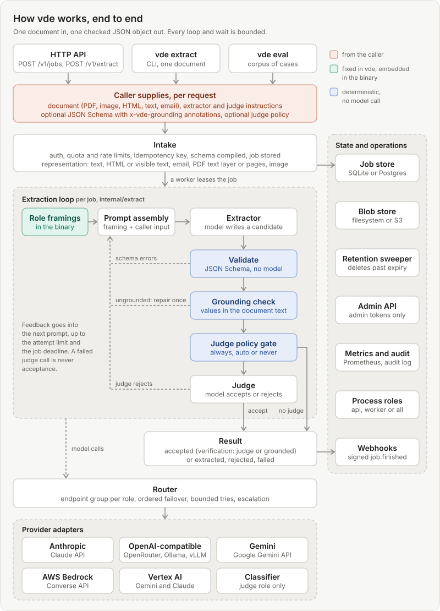
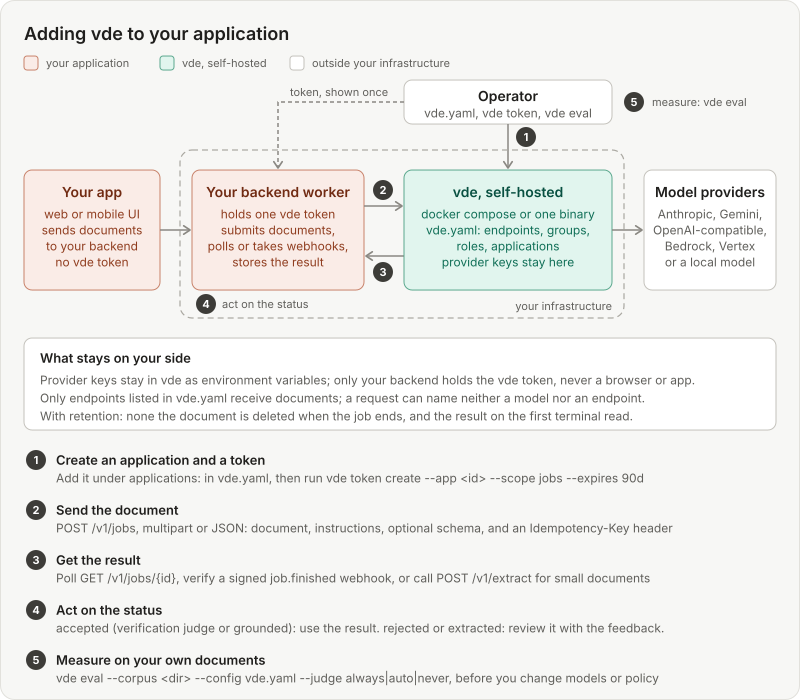

# vde: verified document extraction

[](LICENSE)
[](go.mod)
[](https://github.com/KaanEmec/vde/releases)

`vde` is a self-hosted Go service that turns one document (PDF, image, HTML, text, email)
into one JSON object, and checks it before calling it done. An extractor model produces a
candidate, a separately configured judge model checks it against the source, and the loop
repeats with the judge's feedback until the judge accepts or a bounded attempt limit is
reached. A deterministic grounding check catches values the document never prints. Callers
supply the instructions and, optionally, a JSON Schema per request; the service holds no
domain knowledge.

<p align="center"></p>

## Why

- **A second model checks the first.** The judge sees the same document and the candidate,
  and its rejection becomes feedback for the next attempt. Attempts, failover tries and
  waits are all bounded, and a failed judge call is never acceptance.
- **Invented values are caught without a model.** The grounding check requires every
  extracted string, number and date to occur in the document text. On the owner's ten real
  documents, every judge tested (Gemini Flash, Sonnet, Haiku, GLM, DeepSeek) accepted an
  event invoice whose candidate carried dates, a venue and an organiser the document never
  prints; the grounding check rejects it.
- **Self-hosted and provider-agnostic.** One static, cgo-free binary with SQLite by default.
  Anthropic, OpenAI-compatible endpoints (OpenAI, OpenRouter, Ollama, vLLM), Gemini, AWS
  Bedrock, Vertex AI and classifier judges, with ordered failover per role. Documents reach
  only the endpoints you configure; a request can name neither a model nor an endpoint.
- **Private by default.** Document content never reaches logs, metrics or error messages,
  tokens are stored as hashes, HTTPS is required outside loopback, and `retention: none`
  deletes a job's content on its first terminal read.

## What it does

| Area | Capabilities |
| --- | --- |
| Extraction | Caller-supplied extractor and judge instructions; optional JSON Schema 2020-12 (or schema-less mode); schema violations fed back to the extractor without a judge call; per-role escalation to a stronger group from a given attempt (deprecated, removal in 2.0) |
| Verification | Judge role (an optional second judge is deprecated, removal in 2.0); judge policy `always` (default), `auto` or `never` per application; deterministic grounding check steered by `x-vde-grounding` schema annotations; a `verification` field (`judge`, `grounded`, `none`) on every job |
| Documents | PDF, PNG, JPEG, WebP, HEIC, HTML (raw or visible text), plain text, Markdown, email (`message/rfc822`, attachments listed); PDF text layer or rendered pages prepared in the service (pdfium as WebAssembly); images downscaled and oriented once |
| Providers | `anthropic`, `openai_compatible` (OpenRouter preset), `gemini`, `bedrock`, `vertex`, `classifier` (judge only; deprecated, removal in 2.0); you declare what each model reads; `vde config check` prints how every media type reaches every role |
| Service | `POST /v1/jobs` (multipart or JSON), `GET /v1/jobs/{id}`, synchronous `POST /v1/extract`, signed completion webhooks, idempotency keys, quotas and rate limits, scoped per-application tokens, admin API, OpenAPI at `/v1/openapi.yaml` |
| Operations | SQLite or PostgreSQL, local files or S3; `serve --role api\|worker` for several replicas; retention sweeper; Prometheus metrics; audit log; container image and compose examples; `vde eval` to measure quality on a corpus |

## Quick start

Requires Go 1.26 or newer. The binary is pure Go (`CGO_ENABLED=0`), about 36 MB on
linux/amd64 with pdfium embedded.

### Run one document offline

`--provider-script` replaces every provider with a scripted fake, so no key is needed and
nothing leaves the machine:

```sh
make build                                        # bin/vde
bin/vde extract --config examples/vde.dev.yaml \
  --document examples/samples/booking.txt \
  --extractor-instructions examples/samples/extractor.md \
  --judge-instructions examples/samples/judge.md \
  --provider-script testdata/scenarios/accept-first-try.yaml
```

It prints the job as JSON (`status`, `result`, `feedback`, `attempts`, `verification`,
`service_version`) and exits 0 for `accepted`, 2 `rejected`, 3 `failed`, 4 `extracted`.
Add `--judge auto` to see a result accepted by the grounding check without a judge call
(`verification: grounded`). With a real key, drop `--provider-script`:

```sh
export ANTHROPIC_API_KEY=...
bin/vde config check --config examples/vde.dev.yaml   # no network call
bin/vde extract --config examples/vde.dev.yaml \
  --document examples/samples/booking.pdf --schema examples/samples/schema.json \
  --extractor-instructions examples/samples/extractor.md \
  --judge-instructions examples/samples/judge.md
```

[`examples/`](examples/README.md) has configurations for OpenRouter, Gemini, a fully local
Ollama and cross-provider failover.

### Run the service with docker compose

```sh
cd examples/compose
cp .env.example .env                              # set ANTHROPIC_API_KEY in it
docker compose up -d --build                      # builds this checkout; listens on 127.0.0.1:8090
export VDE_TOKEN=$(docker compose exec -T vde vde token create \
  --app dev-app --scope jobs --expires 2027-12-31 --label "compose dev")
cd ../..
```

Submit a document; the answer is `202` with a job `id`:

```sh
curl -sS http://127.0.0.1:8090/v1/jobs \
  -H "Authorization: Bearer $VDE_TOKEN" \
  -H "Idempotency-Key: booking-v1" \
  -F "document=@examples/samples/booking.txt;type=text/plain; charset=utf-8" \
  -F "extractor_instructions=<examples/samples/extractor.md;type=text/markdown" \
  -F "judge_instructions=<examples/samples/judge.md;type=text/markdown" \
  -F "schema=<examples/samples/schema.json;type=application/schema+json" \
  -F "retention=none"
```

Poll until `status` is terminal (`accepted`, `rejected`, `extracted` or `failed`):

```sh
curl -sS http://127.0.0.1:8090/v1/jobs/<id> -H "Authorization: Bearer $VDE_TOKEN"
```

With `retention: none` the job is gone after that read, so store the result. The
[compose guide](examples/compose/README.md) covers TLS with Caddy, the admin API and
Prometheus; [`examples/compose/scaled/`](examples/compose/scaled/README.md) runs one API and
two worker processes on PostgreSQL and S3. To run the binary as a service instead, see
[install](docs/operator/install.md).

## Integrate it in your application

<p align="center"></p>

1. **Create an application and a token.** Declare the application under `applications:` in
   `vde.yaml` (quota, rate limits, retention, judge policy), then
   `vde token create --app <id> --scope jobs --expires 90d`. The token is printed once and
   belongs in your backend only, never in a browser or a shipped app.
2. **Send the document.** `POST /v1/jobs` as multipart or JSON with the document, both
   instructions and an optional schema. Derive the `Idempotency-Key` from the document and
   your instructions' version, so a retry never pays twice.
3. **Get the result.** Poll `GET /v1/jobs/{id}` (2 s, doubling to 30 s), receive a signed
   `job.finished` webhook and then fetch the job, or call `POST /v1/extract` to wait up to
   `sync.max_wait` for small documents.
4. **Act on the status.** Only `accepted` is acceptance; `verification` says whether the
   judge (`judge`) or the grounding check (`grounded`) accepted it. Send `rejected` and
   `extracted` results to review together with `feedback`, whose JSON pointers name the
   fields in question. Retry `failed` according to `error.code`.
5. **Measure on your own documents.** Put a few dozen labelled documents in a corpus and run
   `vde eval --corpus <dir> --config vde.yaml --judge always` (then `auto`, `never`, with
   `--compare`) before you change models, instructions or policy.

The [API guide](docs/api/guide.md) walks through every call, with runnable clients in
[`docs/api/examples/`](docs/api/examples/) (shell, Node, Swift);
[writing instructions](docs/api/writing-instructions.md) covers the instructions and schema.

## Judge policy and grounding

Each application chooses when the judge is asked:

| Policy | Behaviour | Terminal statuses |
| --- | --- | --- |
| `always` (default) | Every schema-valid candidate goes to the judge; `accepted` means the judge accepted it | `accepted`, `rejected`, `failed` |
| `auto` | Accepted without a judge when the document has text and every critical value is found in it; images, misses and a deterministic 5 % sample go to the judge | `accepted`, `rejected`, `failed` |
| `never` | No judge; a schema-valid result ends `extracted`, which is never acceptance | `extracted`, `rejected`, `failed` |

Why this exists: on the owner's ten real documents (compact instructions, visible-text
emails, page images for PDFs, Haiku 5.5 as extractor and GLM 5.3 Flash as judge), 8 of 10
documents were fully correct, field accuracy was 96.8 % and the cost was about 0.6 cents
per document. The judge was the most expensive step, emails were reliably right on the
first attempt, and no judge caught the invented event details that a plain grounding check
does ([ADR 0009](docs/architecture/decisions/0009-judge-policy-and-grounding.md)).

The schema tells the check which values must be printed and which are derived:

```json
{
  "type": "object",
  "properties": {
    "invoice_number": {"type": "string", "x-vde-grounding": "critical"},
    "issue_date": {"type": "string", "format": "date", "x-vde-grounding": "critical"},
    "total": {"type": "number", "x-vde-grounding": "critical"},
    "currency": {"type": "string", "pattern": "^[A-Z]{3}$", "x-vde-grounding": "derived"},
    "notes": {"type": "string", "x-vde-grounding": "skip"}
  }
}
```

Matching normalizes case, diacritics, thousands separators and decimal conventions, and
recognizes dates printed in six languages. Grounding cannot catch a printed value in the
wrong field, a wrong choice among printed values or an omission; that remains the judge's
job, which is why `auto` samples and `always` stays the default. Details:
[judge policy](docs/operator/judge-policy.md).

## Configuration at a glance

One YAML file, validated in full at start and by `vde config check`; secrets come from
environment variables named in the file.

```yaml
endpoints:
  anthropic:
    provider: anthropic
    api_key_env: ANTHROPIC_API_KEY           # the variable's name, never the key
    models:
      claude-sonnet-4-5: {accepts: [application/pdf, image/png, image/jpeg, text/plain, text/html]}
  gemini:
    provider: gemini
    api_key_env: GEMINI_API_KEY
    models:
      gemini-2.5-flash: {accepts: [application/pdf, image/png, image/jpeg, text/plain, text/html]}

groups:                                      # ordered failover lists
  extraction:
    endpoints:
      - {endpoint: anthropic, model: claude-sonnet-4-5}
      - {endpoint: gemini, model: gemini-2.5-flash}
  review:
    endpoints:
      - {endpoint: gemini, model: gemini-2.5-flash}
      - {endpoint: anthropic, model: claude-sonnet-4-5}

roles:
  extractor: {group: extraction}
  judge: {group: review, policy: always}     # always | auto | never

documents:
  html: visible_text                         # raw_html is the default
  pdf: {mode: auto}                          # text layer or rendered pages for models without PDF input

applications:
  - id: inbox
    name: Inbox importer
    quota: {limit: 1000, window: P1D}
    retention: {default: 24h}
    judge: {policy: auto, sample_rate: 0.05}
```

Every key is in the [configuration reference](docs/operator/configuration.md).

## Documentation

| Topic | Where |
| --- | --- |
| Operator guide: install, configuration, tokens, retention, operations, troubleshooting | [docs/operator/](docs/operator/README.md) |
| API guide and admin API | [docs/api/guide.md](docs/api/guide.md), [docs/api/admin.md](docs/api/admin.md), [OpenAPI](api/openapi.yaml) |
| Judge policy and grounding | [docs/operator/judge-policy.md](docs/operator/judge-policy.md) |
| PDF preprocessing | [docs/operator/pdf.md](docs/operator/pdf.md) |
| Provider adapters | [docs/providers/](docs/providers/README.md) |
| Compatibility policy: what `/v1` and `vde.yaml` promise from 1.0.0 | [docs/compatibility.md](docs/compatibility.md) |
| Security model, hardening and review findings | [docs/security.md](docs/security.md), [SECURITY.md](SECURITY.md) |
| Architecture and decisions | [docs/architecture/overview.md](docs/architecture/overview.md), [ADRs](docs/architecture/decisions/) |
| Roadmap | [docs/roadmap/](docs/roadmap/README.md) |
| Contract conformance | [docs/conformance/travelinbox-v1.md](docs/conformance/travelinbox-v1.md) |
| Measured quality | [docs/quality.md](docs/quality.md), [evaluation](docs/operator/evaluation.md) |
| Changes | [CHANGELOG.md](CHANGELOG.md) |

## Status and roadmap

v0.1 to v0.4 are implemented: the engine and CLI (v0.1); the HTTP service with jobs,
tokens, quota, retention, the admin API and packaging (v0.2); Postgres and S3, Bedrock and
Vertex, the classifier judge, escalation, webhooks, the synchronous endpoint, the
evaluation harness and multiple replicas (v0.3); judge policies, the grounding check and
PDF preparation in the service (v0.4). v1.0 freezes `/v1` and the configuration schema
([compatibility policy](docs/compatibility.md), `vde config schema` for editors), adds a
queue ceiling and in-flight limits with `503` backpressure, and closes a security review
(hardening pass, fuzzers in `make ci`, an independent review; [docs/security.md](docs/security.md)).
A performance baseline and signed releases with SBOMs are deferred.

Not verified yet, so do not treat `vde` as production-ready:

- The Bedrock and Vertex adapters have not run against the live services.
- The classifier judge adapter implements a generic contract; no vendor's classifier has
  been run through it.
- The owner's comparison of `always`, `auto` and `never` on real documents is pending
  ([quality](docs/quality.md#judge-policy)). The first TravelInbox evaluation showed a
  high false-accept rate, mostly convention mismatches that need instruction work.

## Development

```sh
make check          # go vet, golangci-lint, race tests, build
make conformance    # black-box suite for the TravelInbox contract
make eval           # evaluation harness mechanics under each judge policy, fake provider
make live           # opt-in smoke test against every provider whose key is set
make scenarios      # end-to-end scenarios with the fake provider
```

The fake provider is the backbone of the tests; real provider calls run only in `make live`
and manual evaluation runs. Repository layout and conventions are in
[AGENTS.md](AGENTS.md) and [CONTRIBUTING.md](CONTRIBUTING.md).

## License

Apache License 2.0, see [LICENSE](LICENSE). The binary embeds pdfium (BSD-3-Clause)
compiled to WebAssembly, run with go-pdfium (MIT) on wazero (Apache-2.0); see
[NOTICE](NOTICE).
