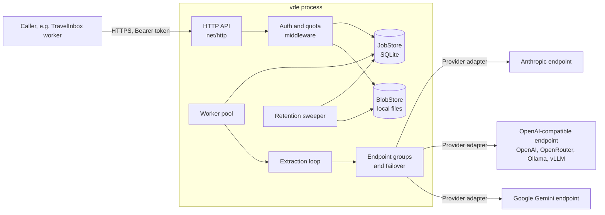

# Architecture overview

Status: in implementation since 2026-10-16. This document describes the target shape of the
service; the roadmap under `docs/roadmap/` says in which order it is built and which jobs are
done. Each job file carries its own `Status`.

## What the service is

A single Go binary, `vde`, that runs an authenticated HTTP service turning one document
(PDF, image, HTML, text) into one JSON object. An **extractor** model produces a candidate,
a **judge** model checks it against the source, and the loop repeats with the judge's
feedback until the judge accepts or a bounded attempt limit is reached. The caller supplies
the instructions and, optionally, a JSON Schema per request; the service holds no domain
knowledge. The first consumer is TravelInbox, whose contract lives in
`FromTravelApp/EXTRACTION-SERVICE-CONTRACT.md` and is treated as the acceptance test of
the first deployable release.

## Design principles

These are deliberate constraints, not aspirations. A change that violates one needs an ADR.

1. **Lean by default.** Standard library first (`net/http` with the Go 1.22+ pattern mux,
   `log/slog`, `database/sql`). A dependency is added when it replaces real code we would
   otherwise write and test ourselves (JSON Schema validation, SQLite driver, YAML parsing),
   not for convenience wrappers. No dependency-injection framework, no code generation
   beyond what the Go toolchain offers, no plugin system.
2. **An interface exists only where a second implementation is planned.** Today that is:
   `Provider` (Anthropic, OpenAI-compatible, Gemini, a fake for tests), `JobStore` and `BlobStore`
   (SQLite plus local files first, Postgres plus S3 later). Everything else is concrete code.
3. **One process, one binary.** API, worker and sweeper run in the same process by default.
   Horizontal scaling is a v0.3 concern and is designed so that it does not change the
   single-process code path (DB leases, not a message broker).
4. **The contract is the spec.** Where the project brief and the TravelInbox contract both
   speak, the contract's MUSTs decide the first release. The service may be a superset
   (schema optional, extra endpoints), never a deviation.
5. **Security is on by default.** No unauthenticated path other than `/healthz`. Document
   content never reaches logs, metrics, traces or error messages. Only operator-configured
   endpoints ever receive documents; a request can name neither endpoint nor model.
6. **Bounded everything.** Every loop (extraction attempts, failover tries, judge re-asks)
   and every wait (per-call timeout, per-job deadline) has a configured upper bound.
   A failed judge call is never acceptance.
7. **Configuration is one YAML file plus environment variables for secrets**, validated
   fully at start and by `vde config check`, with no network calls needed.

## Component view



### Packages (target layout)

```
cmd/vde/                 main: serve, token, app, config check, extract
internal/config/         YAML model, env expansion, validation, service_version hash
internal/provider/       Provider interface, request/response types, capability model
internal/provider/anthropic/
internal/provider/openai/   OpenAI-compatible chat completions (OpenRouter preset)
internal/provider/gemini/
internal/provider/fake/     scripted provider for tests
internal/router/         endpoint groups, ordered failover, per-endpoint health
internal/document/       document model, media types, representation selection, HTML to text, email parsing
internal/extract/        prompt framings, JSON answer parsing, schema validation, judge verdict, loop
internal/api/            handlers, middleware (auth, request id, limits, quota headers), errors, admin routes
internal/auth/           applications, tokens (hashing, expiry, revocation, scopes)
internal/job/            job model, state machine, JobStore interface, SQLite implementation
internal/blob/           BlobStore interface, filesystem implementation
internal/worker/         pool, leasing, job deadline, retention actions
internal/quota/          quota windows and rate limiting
internal/audit/          audit events (never content)
internal/version/        build info
docs/                    architecture, roadmap, operator and API docs
examples/                dev config, docker compose, curl examples
testdata/                fixtures, fake provider scripts, corpus (when licensed)
```

`internal/extract` must be usable without the HTTP layer: the `vde extract` CLI command
and the test suite call it directly with a config and a document. This is why v0.1 ships
the engine and CLI before the service.

## Core flows

### Submit and run a job

1. Middleware: request id, HTTPS check, bearer token lookup (hash), scope check, rate limit,
   quota check. Any failure answers before the body is stored or a model is called.
2. Handler reads the whole multipart body under the configured limits, validates parts,
   compiles the JSON Schema, computes the idempotency hash, picks the document
   representation (or refuses `unsupported_document`), stores blobs and the job row
   (`queued`), charges the quota, answers `202`.
3. A worker leases the job (`running`), runs the extraction loop under the job deadline,
   writes the terminal state, and applies the retention action for document and pages.
4. `GET /v1/jobs/{id}` returns the row; with `retention: none` the first terminal read also
   deletes result, feedback and error. The sweeper deletes everything past `expires_at`.

### Extraction loop (per job)

```
attempt = 0
feedback = []
loop while attempt < limit and deadline not passed:
    attempt++
    candidate = extractor(framing + instructions + schema + representation + prior candidate + feedback)
    if not JSON after lenient cleanup: feedback = [schema: whole result]; continue
    if schema given and candidate invalid: feedback = schema violations; continue   # no judge call
    verdict = judge(framing + instructions + schema + same representation + candidate)
    if verdict unparseable: ask once more; still unparseable -> failed(judge_failed)
    if verdict.accept: accepted (advisory feedback and optional confidence forwarded)
    feedback = verdict.feedback
rejected with last candidate and feedback
```

Provider unavailability inside `extractor()` or `judge()` is handled by the router
(ordered failover, bounded tries and time, never across roles). When the router exhausts
a group the job fails with `provider_unavailable`.

### Representation selection

Decided at submit time from configuration. For each endpoint-model pair the config
declares the media types it accepts natively. If the extractor group has an endpoint that
reads the document's type, the model gets the document bytes; otherwise the `page` images;
otherwise the job is refused (`unsupported_document`): the service never renders pages
itself (ADR 0006). Text, HTML and email bodies are given as text; HTML is sent raw by
default, with a per-application `visible_text` option. The judge always sees the same
representation from the same bytes. The policy is part of `service_version`.

## Data model (v0.2)

- `applications`: id, name, attempt limit, quota limit and window, rate limits, retention
  policy, forced retention flag, created_at.
- `tokens`: id, application_id, sha256 hash, prefix (for display), scopes, expires_at,
  revoked_at, created_at, last_used_at.
- `jobs`: id (ULID, `j_` prefix), application_id, status, attempts, result (JSON),
  feedback (JSON), error (JSON), service_version, representation, media type, size, page
  count, retention, idempotency key and body hash, created_at, started_at, finished_at,
  expires_at, lease_until, content_deleted_at.
- `quota_usage`: application_id, window_start, count.
- Blobs: `document` and `page-N` per job, keyed by job id, in the blob store.
- Audit: append-only table or structured log stream; never content.

SQLite in WAL mode is the default and is sufficient for one VM. The store interface is
small (create, lease next, update state, get, delete content, sweep, idempotency lookup) so
a Postgres implementation in v0.3 is a second file, not a redesign.

## Security model

- Tokens are random, shown once, stored as SHA-256 hashes; a short prefix is kept for
  identification. Expiry and revocation are checked on every request.
- Jobs are scoped to the application that created them; foreign ids answer `404`.
- HTTPS is required outside loopback: either the binary terminates TLS from configured
  cert and key, or the operator declares a trusted reverse proxy and the service requires
  `X-Forwarded-Proto: https`.
- Provider credentials come from environment variables named in the config; they never
  appear in responses, logs or `config check` output.
- Logging uses `slog` with a fixed allow-list of fields; a redaction test asserts that
  document bytes, instructions, schema, candidates and feedback never appear in log output.
- A `debug.log_content` switch exists for local development only, is off by default and
  refuses to start together with a non-loopback listener.

## Versioning

- API version is the base path (`/v1`); changes within it are additive only.
- `service_version` is `vde-<semver>+<8 hex>`, where the hash covers the effective role
  configuration (groups, endpoint-model pairs, capabilities, escalation, attempt limit),
  the fixed framings and the representation policy. It is computed once at start and
  logged.
- Semantic versioning for the binary and image; v0.x may change configuration keys with a
  migration note, v1.0 freezes the API and the configuration schema.

## Decisions

Architecture decisions with their reasoning are in `decisions/`. The ones taken for the
first releases:

- [0001 Go with the standard library HTTP stack](decisions/0001-go-stdlib-http.md)
- [0002 SQLite and local files as the default storage](decisions/0002-sqlite-and-local-blobs.md)
- [0003 In-process worker with database leases, no message broker](decisions/0003-in-process-worker.md)
- [0004 Provider adapters: Anthropic and OpenAI-compatible first](decisions/0004-provider-adapters.md)
- [0005 Contract-first: the TravelInbox contract is the acceptance test](decisions/0005-contract-first.md)
- [0006 Representation policy: raw HTML by default, no server-side rendering](decisions/0006-representation-policy.md)

## Implementation decisions (build start, 2026-10-16)

Concrete choices that the ADRs left open, fixed so parallel work agrees:

| Topic | Choice |
| --- | --- |
| Module path | `github.com/kaanemec/vde` (open question 1 closed; rename is a one-line change) |
| Go | 1.27 toolchain, `go 1.26` in `go.mod` (required by x/net); pure Go, `CGO_ENABLED=0` everywhere |
| YAML | `gopkg.in/yaml.v3` with `KnownFields(true)` |
| JSON Schema 2020-12 | `github.com/santhosh-tekuri/jsonschema/v6` |
| SQLite | `modernc.org/sqlite` via `database/sql`, WAL, one writer |
| IDs | `github.com/oklog/ulid/v2`, job ids `j_<ULID>`, tokens `vde_<prefix>_<random>` |
| Metrics | `github.com/prometheus/client_golang` (v0.2 epic 07) |
| HTML to text | `golang.org/x/net/html`; charsets `golang.org/x/text` |
| CLI | standard `flag` with a hand-written subcommand dispatcher, no framework |
| Tests | standard `testing` only, table-driven, fake provider as the backbone; no testify |

Allowed third-party dependencies are exactly the rows above. Anything else needs an ADR.

### Build order

v0.1 is built in three waves so independent packages proceed in parallel:

1. **Foundation** (sequential): scaffold, `internal/config`, `config check`, and the
   `internal/provider` types every adapter compiles against.
2. **Parallel**: provider adapters (fake, Anthropic, OpenAI-compatible, Gemini),
   `internal/router`, `internal/document` (model, representation, HTML policy, email).
3. **Integration**: `internal/extract` (framings, parsing, schema feedback, verdict, loop,
   schema-less, `service_version`), then `vde extract`, dev config, scenarios, smoke test.

v0.2 follows the same pattern: HTTP foundation, store and worker, packaging in parallel;
then applications and tokens, submission, quota, retention, operations, admin API; then
contract conformance and documentation as the gate.

### Working agreement while building autonomously

Until a remote repository exists, each job lands as one commit on `main` named after the
job file, with the job file's `Status` and the epic table updated in the same commit.
`make check` must pass before a commit. Content never appears in test fixtures that are
logged; fixtures are redacted TravelInbox corpus documents.

## Non-goals for the first releases

Review UI, Temporal or another workflow engine, OCR, server-side PDF rendering (decided
against, ADR 0006), domain-specific integrations, sensitive-data masking inside documents,
multi-document jobs. They are listed in
`docs/roadmap/backlog.md` so they are not forgotten and not accidentally designed in.
