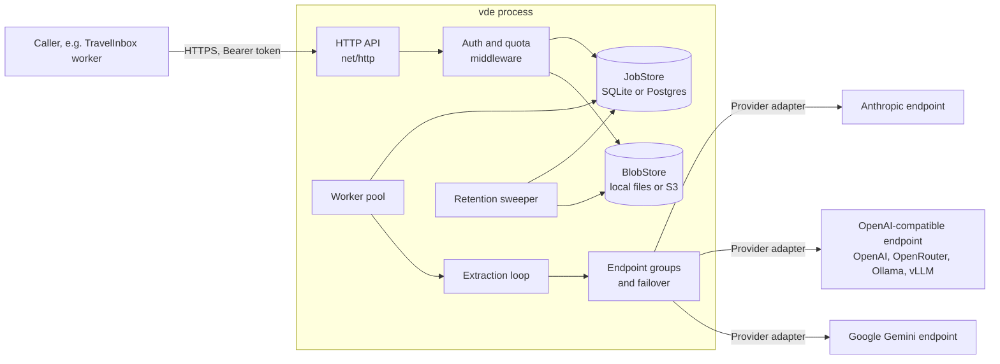

# Architecture overview

Status: v0.1 to v0.4 implemented (v0.4, judge policy, grounding and PDF preprocessing,
ADRs 0009 and 0010, closed 2026-10-18 with the owner's policy comparison pending); v1.0
done 2026-10-18 (`/v1` and the configuration schema frozen, `docs/compatibility.md`;
security review closed, `docs/security.md`; backpressure limits; performance baseline and
release engineering deferred by the owner). This document
describes the shape of the service; the roadmap under `docs/roadmap/` says which jobs are
done. Each job file carries its own `Status`.

## What the service is

A single Go binary, `vde`, that runs an authenticated HTTP service turning one document
(PDF, image, HTML, text, email) into one JSON object. An **extractor** model produces a candidate,
a **judge** model checks it against the source, and the loop repeats with the judge's
feedback until the judge accepts or a bounded attempt limit is reached. Per application
the judge policy (`always`, `never`, `auto`) decides whether the judge is asked; a
deterministic grounding check catches values the document does not contain (ADR 0009). The caller supplies
the instructions and, optionally, a JSON Schema per request; the service holds no domain
knowledge. The first consumer is TravelInbox, whose contract lives in
`FromTravelApp/EXTRACTION-SERVICE-CONTRACT.md` and is treated as the acceptance test of
the first deployable release.

## Design principles

These are deliberate constraints, not aspirations. A change that violates one needs an ADR.

1. **Lean by default.** Standard library first (`net/http` with the Go 1.22+ pattern mux,
   `log/slog`, `database/sql`). A dependency is added when it replaces real code we would
   otherwise write and test ourselves (JSON Schema validation, SQLite driver, YAML parsing),
   not for convenience wrappers. No dependency-injection framework, no code generation
   beyond what the Go toolchain offers, no plugin system.
2. **An interface exists only where a second implementation is planned.** Today that is:
   `Provider` (Anthropic, OpenAI-compatible, Gemini, Bedrock, Vertex, a classifier judge, a fake
   for tests), `JobStore` and `BlobStore` (SQLite plus local files by default, Postgres plus S3). Everything else is concrete code.
3. **One process, one binary.** API, worker and sweeper run in the same process by default.
   `serve --role api|worker` splits them for several replicas without changing the
   single-process code path (DB leases, not a message broker; ADR 0007).
4. **The contract is the spec.** Where the project brief and the TravelInbox contract both
   speak, the contract's MUSTs decide the first release. The service may be a superset
   (schema optional, extra endpoints), never a deviation.
5. **Security is on by default.** No unauthenticated path other than `/healthz`. Document
   content never reaches logs, metrics, traces or error messages. Only operator-configured
   endpoints ever receive documents; a request can name neither endpoint nor model.
6. **Bounded everything.** Every loop (extraction attempts, failover tries, judge re-asks)
   and every wait (per-call timeout, per-job deadline) has a configured upper bound.
   A failed judge call is never acceptance.
7. **Configuration is one YAML file plus environment variables for secrets**, validated
   fully at start and by `vde config check`, with no network calls needed.

## Component view



Other adapters (Bedrock, Vertex, classifier) sit behind the same Router. Everything inside the
box can run as one process or as `api` and `worker` processes sharing Postgres and S3; the
sweeper runs on workers only, holding a Postgres advisory lock so one sweeps at a time. The
webhook sender runs where the worker does.

### Packages

```
cmd/vde/                 main: serve (--role), extract, eval, config check, app, token, audit, migrate, healthcheck, version
api/                     OpenAPI documents (public and admin), embedded
internal/config/         YAML model, env expansion, validation, service_version hash
internal/provider/       Provider interface, request/response types, capability model
internal/provider/anthropic/
internal/provider/openai/   OpenAI-compatible chat completions (OpenRouter preset)
internal/provider/gemini/
internal/provider/bedrock/  AWS Bedrock Converse
internal/provider/vertex/   Vertex AI (Gemini, Anthropic)
internal/provider/classifier/  classifier-style judge (generic classify contract)
internal/provider/fake/     scripted provider for tests
internal/router/         endpoint groups, ordered failover, per-endpoint health
internal/document/       document model, media types, representation selection, image conversion, HTML to text, email parsing, PDF text layer and rendering policy, grounding text
internal/pdf/            pdfium on WebAssembly (go-pdfium, wazero): page count, text layer, page rendering; cgo-free, bounded (ADR 0010)
internal/ground/         deterministic grounding check: normalization, number and date matching, x-vde-grounding rules (ADR 0009)
internal/extract/        prompt framings, JSON answer parsing, schema validation, judge verdict, loop, escalation, judge policy (grounding repair, auto gate, sampling)
internal/api/            handlers, middleware (auth, request id, limits), quota windows and rate limiting, errors, admin routes, sync endpoint, JSON submission and URL fetch
internal/auth/           applications, tokens (hashing, expiry, revocation, scopes)
internal/job/            job model, state machine, JobStore, SQLite and Postgres implementations, migrations and migrations_postgres
internal/blob/           BlobStore interface, filesystem and S3 implementations
internal/worker/         pool, leasing, job deadline, retention actions
internal/sweeper/        expiry sweeper, advisory-locked across processes
internal/webhook/        signed completion webhooks
internal/eval/           evaluation harness: corpus, case globs, comparison, report (verification, judge calls per case)
internal/audit/          audit events (never content)
internal/logging/        slog setup and redaction
internal/metrics/        Prometheus metrics
internal/version/        build info
test/conformance/        black-box suite for the TravelInbox contract's acceptance items
docs/                    architecture, roadmap, operator and API docs
examples/                dev config, docker compose (single and scaled), samples
testdata/                fixtures, fake provider scripts, evaluation corpus
```

`internal/extract` must be usable without the HTTP layer: the `vde extract` CLI command
and the test suite call it directly with a config and a document. This is why v0.1 ships
the engine and CLI before the service.

## Core flows

### Submit and run a job

1. Middleware: request id, HTTPS check, bearer token lookup (hash), scope check, rate limit,
   quota check. Any failure answers before the body is stored or a model is called.
2. Handler reads the whole multipart body under the configured limits, validates parts,
   compiles the JSON Schema, computes the idempotency hash, picks the document
   representation (or refuses `unsupported_document`), stores blobs and the job row
   (`queued`), charges the quota, answers `202`.
3. A worker leases the job (`running`), runs the extraction loop under the job deadline,
   writes the terminal state, and applies the retention action for document and pages.
4. `GET /v1/jobs/{id}` returns the row; with `retention: none` the first terminal read also
   deletes result, feedback and error. The sweeper deletes everything past `expires_at`.

### Extraction loop (per job)

```
policy = job.judge_policy                     # always | never | auto (ADR 0009)
text = grounding text of the representation   # none for images and PDFs without a text layer
attempt = 0
feedback = []
loop while attempt < limit and deadline not passed:
    attempt++
    candidate = extractor(framing + instructions + schema + representation + prior candidate + feedback)
    if not JSON after lenient cleanup: feedback = [schema: whole result]; continue
    if schema given and candidate invalid: feedback = schema violations; continue   # no judge call
    grounding = check(candidate, text, schema's x-vde-grounding rules)   # deterministic, no model
    if policy == never:
        extracted, verification none (grounding entries as advisory feedback)     # no judge
    if policy in (always, auto) and critical leaves ungrounded
            and no repair made in this job and attempt < limit:
        feedback = grounding entries; mark repair made (persisted); continue       # no judge call
    if policy == auto and text exists and a critical leaf was checked
            and every critical leaf grounded and candidate answers no schema or judge feedback:
        if not sampled(job id, sample_rate):
            accepted, verification grounded, judge_confidence null               # no judge
        # sampled: judged below; a rejection counts a disagreement
    verdict = judge(framing + instructions + schema + same representation + candidate)
    if verdict unparseable: ask once more; still unparseable -> failed(judge_failed)
    if verdict.accept: accepted, verification judge (advisory feedback, optional confidence)
    feedback = verdict.feedback (+ grounding entries under auto)
rejected with last candidate and feedback, verification none
# under always, grounding entries never reach the job's feedback
```

Provider unavailability inside `extractor()` or `judge()` is handled by the router
(ordered failover, bounded tries and time, never across roles). When the router exhausts
a group the job fails with `provider_unavailable`.

### Representation selection

Decided at submit time from configuration, and repeated by the worker with the same
policies and the same bytes (so a resumed job gets the identical representation). For each
endpoint-model pair the config declares the media types it accepts natively. If every
group of both roles has a pair that reads the document's type, the models get the document
bytes; otherwise the caller's `page` images when the groups read them. Text, HTML and
email bodies are given as text; HTML is sent raw by default, with a per-application
`visible_text` option; images are prepared once (`documents.images`).

A PDF that the groups do not read natively, without caller pages, is prepared by the
service ([ADR 0010](decisions/0010-pdf-preprocessing-in-service.md), amending ADR 0006)
under `documents.pdf.mode`: `auto` (default) sends the text layer as text when every page
has at least `min_text_chars_per_page` characters and renders the pages (PNG at `dpi`)
otherwise; `text` and `pages` force one of the two; `native` prepares nothing and refuses
such a PDF with `unsupported_document`, the v0.3 behaviour. pdfium runs as WebAssembly
(`internal/pdf`), started lazily, one bounded pool per process. Anything no group can read
is refused (`unsupported_document`). The judge always sees the same representation from
the same bytes.

Each representation also carries its grounding text for ADR 0009: the text itself, the
visible text of HTML and email, or a PDF's text layer (read even when the models get the
PDF or pages, but only under `never` and `auto`). Images are ungroundable. The HTML, image
and PDF policies are part of `service_version`.

## Data model

- `applications`: id, name, attempt limit, quota limit and window, rate limits, retention
  policy, forced retention flag, HTML policy, judge settings (`judge_policy`,
  `judge_allow_override`, `judge_sample_rate`; v0.4), enabled, source (`config` or
  `admin`), created_at, updated_at.
- `tokens`: id, application_id (NULL for admin tokens, whose only scope is `admin`),
  sha256 hash, prefix (for display), scopes, expires_at, revoked_at, created_at,
  last_used_at.
- `jobs`: id (ULID, `j_` prefix), application_id, status (`extracted` added in v0.4),
  judge_policy (the effective policy the job runs under, v0.4), verification (`judge`,
  `grounded`, `none`; empty until terminal, v0.4), attempts, result (JSON),
  feedback (JSON), error (JSON), service_version, representation, media type, size, page
  count, retention, idempotency key and body hash, attachment list (JSON, email only),
  input_tokens and output_tokens (provider usage, summed over attempts and re-leases),
  created_at, started_at, finished_at, expires_at, lease_until, content_deleted_at (set when
  content was deleted; a replay of the job's idempotency key reports it).
- `quota_usage`: application_id, window_start, count.
- `rate_windows`: application_id, kind (`requests` or `submits`), window_start (UTC minute),
  count; used only with `rate.shared: true`, pruned by the sweeper.
- Blobs: `document` and `page-N` per job, keyed by job id, in the blob store.
- Audit: the append-only `audit_events` table (and optionally `audit.log`); never content.

SQLite in WAL mode is the default and is sufficient for one VM. The store interface is
small (create, lease next, update state, get, delete content, sweep, idempotency lookup);
Postgres is a second driver over the same statements (`FOR UPDATE SKIP LOCKED` for leasing),
and S3 a second blob implementation. See ADR 0007.

## Security model

- Tokens are random, shown once, stored as SHA-256 hashes; a short prefix is kept for
  identification. Expiry and revocation are checked on every request.
- Jobs are scoped to the application that created them; foreign ids answer `404`.
- HTTPS is required outside loopback: either the binary terminates TLS from configured
  cert and key, or the operator declares a trusted reverse proxy and the service requires
  `X-Forwarded-Proto: https`.
- Provider credentials come from environment variables named in the config; they never
  appear in responses, logs or `config check` output.
- Logging uses `slog` with a fixed allow-list of fields; a redaction test asserts that
  document bytes, instructions, schema, candidates and feedback never appear in log output.
- No mode logs content: the `debug.log_content` key is deprecated, has no effect and is
  removed in 2.0.

## Versioning

- API version is the base path (`/v1`); changes within it are additive only.
- `service_version` is `vde-<semver>+<8 hex>`, where the hash covers the effective role
  configuration (groups, endpoint-model pairs, capabilities, escalation, second judge,
  attempt limit), the fixed framings, the representation policy (HTML, images, and the PDF
  mode, dpi and minimum characters when a PDF may be prepared), the judge policy (`never`
  and `auto`; the sample rate under `auto`) and the grounding rules version (`ground-2`,
  under every policy, since `always` makes the grounding repair for annotated schemas). An application has one
  `service_version` per policy it may run under, and each job carries the one it ran with.
  It is computed at start and logged.
- Semantic versioning for the binary and image; v0.x may change configuration keys with a
  migration note, v1.0 freezes the API and the configuration schema
  (`docs/compatibility.md`: `api/openapi.v1.0.0.yaml` and `internal/config/schema.json`
  are the frozen documents, guarded by tests).

## Decisions

Architecture decisions with their reasoning are in `decisions/`. The ones taken for the
first releases:

- [0001 Go with the standard library HTTP stack](decisions/0001-go-stdlib-http.md)
- [0002 SQLite and local files as the default storage](decisions/0002-sqlite-and-local-blobs.md)
- [0003 In-process worker with database leases, no message broker](decisions/0003-in-process-worker.md)
- [0004 Provider adapters: Anthropic and OpenAI-compatible first](decisions/0004-provider-adapters.md)
- [0005 Contract-first: the TravelInbox contract is the acceptance test](decisions/0005-contract-first.md)
- [0006 Representation policy: raw HTML by default, no server-side rendering](decisions/0006-representation-policy.md)
- [0007 Storage drivers and process roles](decisions/0007-storage-drivers-and-process-roles.md)
- [0008 Judge quality is measured, not assumed](decisions/0008-judge-quality-measurement.md)
- [0009 Judge policy and a deterministic grounding check](decisions/0009-judge-policy-and-grounding.md)
- [0010 PDF preprocessing in the service (amends 0006)](decisions/0010-pdf-preprocessing-in-service.md)

## Implementation decisions (build start, 2026-10-16)

Concrete choices that the ADRs left open, fixed so parallel work agrees:

| Topic | Choice |
| --- | --- |
| Module path | `github.com/kaanemec/vde` (open question 1 closed; rename is a one-line change) |
| Go | `toolchain go1.26.9` in `go.mod` (images and release binaries build with it), `go 1.26` in `go.mod` (required by x/net); pure Go, `CGO_ENABLED=0` everywhere |
| YAML | `gopkg.in/yaml.v3` with `KnownFields(true)` |
| JSON Schema 2020-12 | `github.com/santhosh-tekuri/jsonschema/v6` |
| SQLite | `modernc.org/sqlite` via `database/sql`, WAL, one writer |
| IDs | `github.com/oklog/ulid/v2`, job ids `j_<ULID>`, tokens `vde_<prefix>_<random>` |
| Metrics | `github.com/prometheus/client_golang` (v0.2 epic 07) |
| HTML to text | `golang.org/x/net/html`; charsets `golang.org/x/text` |
| PDF text and rendering | `github.com/klippa-app/go-pdfium` (MIT) on `github.com/tetratelabs/wazero` (Apache-2.0), pdfium embedded as WebAssembly (BSD-3-Clause); licenses in `NOTICE` (v0.4, ADR 0010) |
| CLI | standard `flag` with a hand-written subcommand dispatcher, no framework |
| Tests | standard `testing` only, table-driven, fake provider as the backbone; no testify |

Allowed third-party dependencies are exactly the rows above. Anything else needs an ADR.

### Build order

v0.1 is built in three waves so independent packages proceed in parallel:

1. **Foundation** (sequential): scaffold, `internal/config`, `config check`, and the
   `internal/provider` types every adapter compiles against.
2. **Parallel**: provider adapters (fake, Anthropic, OpenAI-compatible, Gemini),
   `internal/router`, `internal/document` (model, representation, HTML policy, email).
3. **Integration**: `internal/extract` (framings, parsing, schema feedback, verdict, loop,
   schema-less, `service_version`), then `vde extract`, dev config, scenarios, smoke test.

v0.2 follows the same pattern: HTTP foundation, store and worker, packaging in parallel;
then applications and tokens, submission, quota, retention, operations, admin API; then
contract conformance and documentation as the gate.

### Working agreement while building autonomously

Until a remote repository exists, each job lands as one commit on `main` named after the
job file, with the job file's `Status` and the epic table updated in the same commit.
`make check` must pass before a commit. Content never appears in test fixtures that are
logged; fixtures are redacted TravelInbox corpus documents.

## Non-goals for the first releases

Review UI, Temporal or another workflow engine, OCR (a scanned PDF is rendered, not read),
HEIC conversion, a per-application role set, domain-specific integrations, sensitive-data masking inside documents,
multi-document jobs. They are listed in
`docs/roadmap/backlog.md` so they are not forgotten and not accidentally designed in.
